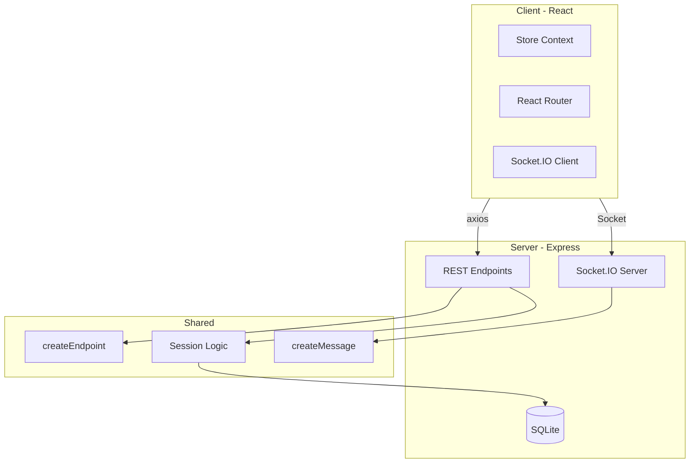

# HappiKaraoke Project Analysis

> Analysis performed March 2025. Plan to be enacted later as desired.

## Summary

The project has a **solid architecture** (client/server/shared separation, typed endpoints, Drizzle ORM) and **good documentation** (README, ARCHITECTURE.md, karaoke invariants). However, there are **critical security issues** and several areas for improvement.

---

## Critical Issues

### 1. Path Traversal in `saveSong` (Security)

**File:** [src/shared/endpoints/ai.ts](src/shared/endpoints/ai.ts) (lines 271-274)

The `filename` from `req.body` is used directly without validation:

```typescript
const filePath = join(songsFolder, filename);
writeFileSync(filePath, content, "utf-8");
```

An attacker can send `filename: "../../../etc/passwd"` or similar to write outside the songs folder.

**Fix:** Resolve the path and ensure it stays under `songsFolder`:

```typescript
const resolvedPath = resolve(songsFolder, filename);
if (!resolvedPath.startsWith(resolve(songsFolder))) {
  res.status(400).json({ error: "Invalid filename" });
  return;
}
```

Also sanitize `filename` to reject `../`, absolute paths, and control characters.

---

### 2. Hardcoded Admin Password

**File:** [src/shared/config/index.ts](src/shared/config/index.ts)

```typescript
ADMIN_PASSWORD: 'Ab=G#',
```

- Committed to git; anyone with repo access knows the password
- Cannot be changed without code change

**Fix:** Use `process.env.HAPPIKARAOKE_ADMIN_PASSWORD` with fallback for dev, or add first-run setup flow to set password and store hashed value in DB.

---

### 3. No Authentication on Sensitive Endpoints

Most endpoints are **unauthenticated**. Only `changeSong` and `refreshSession` call `checkAndRefreshSession()`. These are reachable by any device on the LAN:

| Endpoint | Risk |
| --- | --- |
| `setSongsFolder` | Change songs directory; path traversal |
| `setOpenAIKey` | Store/overwrite API keys |
| `saveSong` | Write arbitrary files (with path traversal) |
| `addToQueue`, `clearQueue`, `reorderQueue` | Modify queue |
| `closeSession`, `deleteSessionLog` | Session management |
| `fetchSessionLog`, `fetchAllSessions` | Data exposure |

**Fix:** Add auth middleware that validates `userId` + session from cookie/header and restricts admin-only endpoints. Apply to all endpoints that modify state or access sensitive data.

---

### 4. Socket.IO Connection Without Auth

**File:** [src/server/server.ts](src/server/server.ts) (lines 40-45)

```typescript
serverSocket.on("connection", (socket) => {
  messages.forEach((message) => message.server.register(socket));
});
```

Any client can connect and receive broadcasts. For a LAN karaoke app this may be acceptable, but consider validating session/cookie on connection if you add auth.

---

## Moderate Issues

### 5. `createEndpoint` Has No Error Handling

**File:** [src/shared/types/endpoints.ts](src/shared/types/endpoints.ts)

Handlers are registered directly without a try/catch wrapper. Unhandled promise rejections or thrown errors can crash the server or return unhelpful 500s.

**Fix:** Wrap the handler in `createEndpoint`:

```typescript
app[method](url, async (req, res) => {
  try {
    await handler(req, res);
  } catch (err) {
    console.error(err);
    if (!res.headersSent)
      res.status(500).json({ error: "Internal server error" });
  }
});
```

---

### 6. Inconsistent Input Validation

Only a few endpoints use Zod (e.g. `JoinSession`). Most rely on manual `req.body` checks. Endpoints like `fetchSessionLog`, `deleteSessionLog` take `sessionId` without validation.

**Fix:** Add Zod schemas to `createEndpoint` or use a validation middleware. Validate `sessionId` as positive integer, `filename` as safe string, etc.

---

### 7. Unused Dependencies

- **sqlite3** – Project uses `better-sqlite3`; `sqlite3` appears unused (possibly a transitive dep of drizzle-kit).
- **vite-express** – Not used; Vite middleware is wired directly in [src/server/server.ts](src/server/server.ts).

**Fix:** Remove `vite-express` from `package.json`. Verify `sqlite3` usage and remove if unused.

---

### 8. Drizzle Config Mismatch

**File:** [drizzle.config.ts](drizzle.config.ts) has `out: './drizzle'`, but [package.json](package.json) overrides with `--out migrations`:

```json
"db:migration:generate": "npm exec drizzle-kit generate --out migrations ..."
```

Migrations end up in `migrations/`, not `drizzle/`. Either align `drizzle.config.ts` with `migrations` or drop the CLI override.

---

## Key Improvements

### 9. Expand Test Coverage

**Current:** Only 2 invariant tests ([tests/invariants/scroll.spec.ts](tests/invariants/scroll.spec.ts), [tests/invariants/sections.spec.ts](tests/invariants/sections.spec.ts)) for scroll/section logic.

**Recommendations:**

- **API tests:** Use supertest or similar to test endpoints (auth, validation, error handling).
- **Integration tests:** Test session flow, queue operations, song loading.
- **E2E (optional):** Playwright for critical flows (login, join, scroll sync).

---

### 10. API Keys at Rest

API keys are stored in the `config` table. Consider encrypting them (e.g. with a key derived from a secret in env) if the DB file could be copied.

---

### 11. CSP `connect-src`

**File:** [src/client/index.html](src/client/index.html)

```html
connect-src *
```

Allows connections to any origin. For a LAN app this may be intentional, but consider restricting to `'self'` and the host URL if possible.

---

### 12. `setSongsFolder` Path Validation

**File:** [src/shared/endpoints/session.ts](src/shared/endpoints/session.ts)

`folder` from `req.body` is used directly. Validate that it is an absolute path under a safe base (e.g. user home or app data) to avoid path traversal.

---

## Architecture Diagram



**Note:** Endpoints and session logic lack a central auth layer; each endpoint handles (or omits) auth independently.

---

## Priority Order

| Priority | Item | Effort |
| --- | --- | --- |
| P0 | Path traversal in `saveSong` | Low |
| P0 | Auth middleware for admin endpoints | Medium |
| P1 | Configurable admin password | Low |
| P1 | Global error handling in `createEndpoint` | Low |
| P2 | Input validation (Zod) for API | Medium |
| P2 | Remove unused deps, fix drizzle config | Low |
| P3 | Expand test coverage | Medium-High |
| P3 | API key encryption, CSP tightening | Low-Medium |

---

## Positive Aspects

- Clear separation of client/server/shared
- Typed endpoint and message contracts
- Documented karaoke invariants and test coverage for them
- Solid README and architecture docs
- Modern stack (React 18, Vite 5, Drizzle, Socket.IO)
